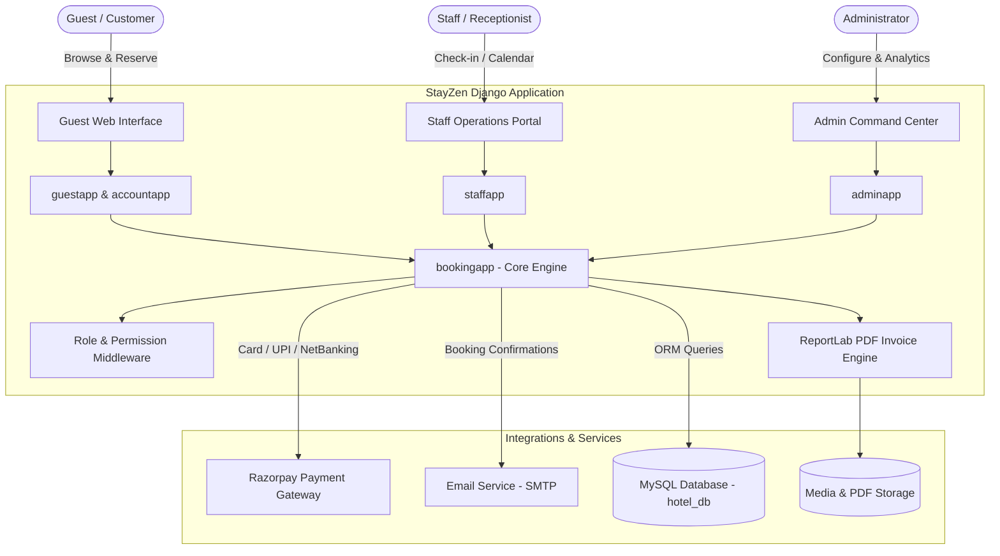
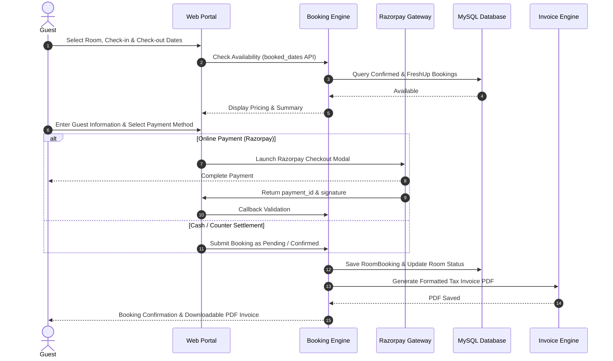
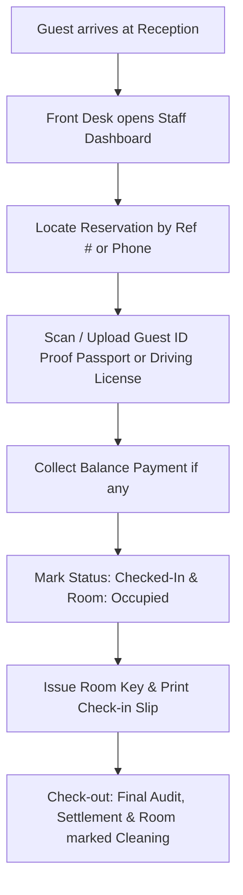

<div align="center">

# 🏨 StayZen - Luxury Resort & Hotel Management System

[](https://www.djangoproject.com/)
[](https://www.python.org/)
[](https://www.mysql.com/)
[](https://getbootstrap.com/)
[](https://razorpay.com/)
[](LICENSE)

*An enterprise-grade, full-stack resort and hospitality management platform engineered with Django and MySQL, featuring automated room reservations, event/banquet booking, hourly fresh-up stays, fine dining management, dynamic role-based access control (RBAC), real-time staff operations, and automated PDF invoice generation.*

</div>

---

## 📑 Table of Contents

- [Overview](#-overview)
- [Key Features](#-key-features)
- [System Architecture](#-system-architecture)
- [Detailed Workflows](#-detailed-workflows)
- [Tech Stack](#-tech-stack)
- [Directory Structure](#-directory-structure)
- [Prerequisites](#-prerequisites)
- [Installation & Quickstart](#-installation--quickstart)
- [Environment Variables](#-environment-variables)
- [Running Tests](#-running-tests)
- [User Roles & Permissions](#-user-roles--permissions)
- [Contributing](#-contributing)
- [License](#-license)

---

## 🌟 Overview

**StayZen** is an all-in-one hospitality management solution designed to streamline the entire resort operations lifecycle. From a seamless, responsive guest booking portal to a sophisticated staff operations dashboard and administrative command center, StayZen bridges the gap between customer luxury experience and back-office management.

Powered by a relational **MySQL** database backend, StayZen ensures high transaction integrity, robust security, and reliable data management for suite reservations, hourly fresh-up rooms, banquet bookings, fine dining reservations, staff shifts, and check-in verifications.

---

## 🚀 Key Features

### 🛎️ Room & Suite Management
- **Room Catalog & Real-Time Availability**: Browse room types (Deluxe, Executive, Presidential Suite) with high-definition image galleries, room specs, and amenities.
- **Conflict Prevention Engine**: Real-time calendar availability engine that strictly prevents overlapping bookings and race conditions.
- **Hourly Fresh-Up Booking**: Book short-term (1-6 hours) stays for quick layovers, transit guests, or refreshment with automatic date/slot calendar blocking.
- **Dynamic Pricing & Advance Payments**: Flexible advance token deposits or complete payments with automated balance settlement at check-out.

### 🏛️ Banquet & Event Hall Reservations
- **Multi-Hall Booking**: Reserve grand ballrooms, conference halls, and lawn event venues.
- **Smart Time-Slot Validation**: Intelligent time logic ensuring that start and end times are validated accurately for both same-day and multi-day events.
- **Add-on Facilities & Event Types**: Weddings, corporate galas, private banquets with equipment and catering configuration.

### 🍽️ Restaurant & Dining Management
- **Table Reservations**: Book indoor and outdoor dining tables with specific guest counts, date, and meal time slots.
- **Digital Food Menu & Cart**: Interactive food ordering experience with category filtering, real-time cart counter, and special chef instructions.
- **Order Dispatch & Delivery Tracking**: Assign food orders to active staff members with real-time status updates (Pending, In Preparation, Out for Delivery, Delivered).

### 🧘 Wellness, Spa & Activities
- **Activity Scheduling**: Explore and book resort activities such as Spa & Massage, Morning Yoga, Lawn Tennis, Golf Sessions, and Zumba classes.
- **Capacity & Session Slots**: Automated participant limits and slot availability management.

### 💳 Payments, Billing & Automated Invoicing
- **Razorpay Payment Gateway**: Seamless online payment processing via Razorpay Checkout modal for cards, UPI, net banking, and wallets.
- **Counter / Cash on Arrival**: Cash payment workflows with immediate receipt generation.
- **Automated PDF Invoices**: Instant PDF invoice generation built with **ReportLab**, featuring customized branding, breakdown of room charges, taxes, advance adjustments, and QR/reference codes.

### 👥 Staff Operations & Dynamic RBAC
- **Custom Permission Middleware**: Granular Menu and SubMenu permission controls per staff role/department (Front Desk, Housekeeping, Restaurant, Kitchen, Management).
- **Interactive Calendar Dashboard**: Visual grid displaying daily room occupancy, incoming check-ins, departures, and ongoing bookings.
- **Guest Check-in & ID Proof Verification**: Upload and verify guest identification documents (Passport, National ID, Driving License) during check-in.
- **Attendance & Shift Roster**: Clock-in/clock-out tracking, status flags (Present, Late, Absent, Half Day), and shift schedules.

### 🎁 Loyalty Points & Customer Engagement
- **Loyalty Program**: Automatic accumulation of loyalty points on completed stays and dining.
- **Redemption**: Guests can apply accumulated points for instant bill discounts.
- **Contact & Inquiry Portal**: Direct guest messaging and feedback routing.

---

## 🏗️ System Architecture



---

## 🔄 Detailed Workflows

### 1. Room Booking Lifecycle


### 2. Hourly Fresh-Up Room Workflow

```mermaid
flowchart LR
    A[Guest requests Fresh-Up] --> B[Select Hours Required 1-6 hrs]
    B --> C[Check Room Current State]
    C -->|Room Available| D[Assign Room Instantly]
    D --> E[Block Calendar for Selected Hours]
    E --> F[Process Payment Cash or Razorpay]
    F --> G[Generate Instant Check-in Ticket]
    G --> H[Room Automatically Cleared after Expiration]
```


### 3. Staff Check-In & Verification Workflow


---

## 💻 Tech Stack

| Domain | Technologies |
|---|---|
| **Backend Framework** | [Django](https://www.djangoproject.com/) 6.0+, [Django REST Framework](https://www.django-rest-framework.org/) |
| **Programming Language** | [Python](https://www.python.org/) 3.10+ / 3.11 / 3.12 |
| **Database** | [MySQL](https://www.mysql.com/) 8.0+ / [MariaDB](https://mariadb.org/) |
| **Frontend UI** | HTML5, CSS3, JavaScript (ES6+), [Bootstrap 5](https://getbootstrap.com/), [FontAwesome](https://fontawesome.com/) |
| **Date & Calendar Tools** | [Flatpickr](https://flatpickr.js.org/), FullCalendar, Custom Canvas & Timeline Visualizer |
| **PDF Generation** | [ReportLab](https://www.reportlab.com/) |
| **Payment Gateway** | [Razorpay](https://razorpay.com/) Payment SDK & Checkout.js |
| **Authentication & RBAC** | Custom Authentication Backends (Email or Username), Granular Middleware Permissions |

---

## 📁 Directory Structure

```text
StayZen/
├── manage.py                       # Django CLI management utility
├── requirements.txt                # Python project dependencies
├── .env.example                    # Environment configuration template
├── .gitignore                      # Git ignore patterns
├── README.md                       # Repository documentation
├── seed_reports_data.py            # Analytics & reports seeding utility
│
├── stayzen/                        # Project configuration directory
│   ├── __init__.py
│   ├── asgi.py                     # ASGI entry point for async servers
│   ├── backends.py                 # Custom email-or-username authentication backend
│   ├── settings.py                 # Main configuration settings & environment loader
│   ├── urls.py                     # Global URL routing
│   └── wsgi.py                     # WSGI entry point for production servers
│
├── accountapp/                     # Authentication & User Account Management
│   ├── models.py                   # Customer profile, Cart, CartItem models
│   ├── forms.py                    # User registration, login, and profile forms
│   ├── urls.py                     # Account route definitions
│   └── views.py                    # Login, register, profile, cart endpoints
│
├── adminapp/                       # Resort Administration & Management
│   ├── models.py                   # Room, EventHall, FoodItem, Activity, StaffUser, SiteSettings
│   ├── forms.py                    # Admin management forms
│   ├── context_processors.py       # Global site settings processor
│   ├── urls.py                     # Admin routing
│   └── views.py                    # Room, banquet, dining, staff, reports controllers
│
├── bookingapp/                     # Core Reservations & Transactions Engine
│   ├── models.py                   # RoomBooking, FreshUpBooking, TableReservation, Order, EventBooking
│   ├── views.py                    # Booking controllers, availability APIs, Razorpay handlers
│   ├── loyalty.py                  # Loyalty point calculation & reward algorithms
│   ├── utils.py                    # PDF invoice generation with ReportLab
│   ├── signals.py                  # Database triggers & post-save listeners
│   └── urls.py                     # Booking route endpoints
│
├── guestapp/                       # Public Guest Portal
│   ├── models.py                   # ContactMessage & feedback models
│   ├── views.py                    # Home, room showcase, dining, activity pages
│   ├── templatetags/               # Custom Django template tags (e.g. cart badge count)
│   └── urls.py                     # Guest navigation routes
│
├── staffapp/                       # Staff Operations & Calendar Dashboard
│   ├── models.py                   # Menu, SubMenu, MenuPermission, Shift, Attendance
│   ├── middleware.py               # RBAC permission enforcer & cache control
│   ├── context_processor.py        # Dynamic menu navigation based on staff permissions
│   ├── permissions.py              # Permission evaluation helpers
│   ├── views.py                    # Staff calendar, check-in, check-out, shift controllers
│   └── urls.py                     # Staff portal routes
│
├── static/                         # Static assets (CSS, JavaScript, Images, Vendor libraries)
├── media/                          # Room photos, food menus, activity banners, resort assets
└── templates/                      # Django HTML Templates
    ├── account/                    # Authentication templates
    ├── admin/                      # Admin dashboard templates
    ├── booking/                    # Booking confirmation & detail templates
    ├── guest/                      # Guest portal templates
    └── staff/                      # Staff calendar & operations templates
```

---

## ⚙️ Prerequisites

Make sure the following software is installed on your workstation or server:

1. **Python**: Version `3.10` or higher (`python --version`)
2. **Git**: (`git --version`)
3. **Database**: [MySQL Server 8.0+](https://dev.mysql.com/downloads/mysql/) (or [XAMPP](https://www.apachefriends.org/) / WAMP / MariaDB)
4. **C/C++ Build Tools** *(Optional, if compiling mysqlclient on Windows without pre-built wheels)*

---

## 🛠️ Installation & Quickstart

### 1. Clone the Repository
```bash
git clone https://github.com/Gouri4666/stayzen.git
cd stayzen
```

### 2. Create and Activate a Virtual Environment

**On Windows (PowerShell):**
```powershell
python -m venv env
.\env\Scripts\Activate.ps1
```

**On Windows (Command Prompt):**
```cmd
python -m venv env
env\Scripts\activate.bat
```

**On macOS / Linux:**
```bash
python3 -m venv env
source env/bin/activate
```

### 3. Install Dependencies
```bash
pip install --upgrade pip
pip install -r requirements.txt
```

### 4. Configure Environment Variables
Create your local environment file by copying `.env.example`:
```bash
# On Windows PowerShell
Copy-Item .env.example .env

# On Linux / macOS
cp .env.example .env
```
Edit `.env` with your MySQL database credentials and email settings.

### 5. Initialize the MySQL Database
Ensure your MySQL service is active (via XAMPP, MySQL Workbench, or Windows Service) and create the database:
```sql
CREATE DATABASE hotel_db CHARACTER SET utf8mb4 COLLATE utf8mb4_unicode_ci;
```

Apply all Django migrations to build the tables:
```bash
python manage.py migrate
```

### 6. Create a Superuser / Administrator
```bash
python manage.py createsuperuser
```
Follow the interactive prompts to set your admin username, email, and password.

### 7. (Optional) Seed Sample Report Data
Populate demo reports and booking statistics:
```bash
python seed_reports_data.py
```

### 8. Run the Development Server
```bash
python manage.py runserver
```

Open your browser and navigate to:
- **Guest Portal**: `http://127.0.0.1:8000/`
- **Staff Portal**: `http://127.0.0.1:8000/staff/`
- **Admin Dashboard**: `http://127.0.0.1:8000/adminapp/`
- **Django Admin**: `http://127.0.0.1:8000/admin/`

---

## 🔐 Environment Variables

| Variable | Description | Default | Example |
|---|---|---|---|
| `SECRET_KEY` | Django cryptographic secret key | *Development Key* | `django-insecure-xyz...` |
| `DEBUG` | Enable/Disable debug mode | `True` | `True` or `False` |
| `ALLOWED_HOSTS` | Comma-separated allowed hostnames | `*` | `127.0.0.1,localhost` |
| `DB_ENGINE` | Database backend engine | `django.db.backends.mysql` | `django.db.backends.mysql` |
| `DB_NAME` | Database name | `hotel_db` | `hotel_db` |
| `DB_USER` | Database user account | `root` | `root` |
| `DB_PASSWORD` | Database user password | *Empty* | `your_mysql_password` |
| `DB_HOST` | Database host address | `localhost` | `127.0.0.1` |
| `DB_PORT` | Database server port | `3306` | `3306` |
| `EMAIL_BACKEND` | Email backend class | `smtp.EmailBackend` | `smtp.EmailBackend` |
| `EMAIL_HOST` | SMTP server address | `smtp.gmail.com` | `smtp.gmail.com` |
| `EMAIL_PORT` | SMTP port | `587` | `587` |
| `EMAIL_USE_TLS` | Enable TLS security | `True` | `True` |
| `EMAIL_HOST_USER`| SMTP authentication email | `stayzen70@gmail.com` | `your_account@gmail.com` |
| `EMAIL_HOST_PASSWORD`| SMTP authentication app password | *Empty* | `abcdefghijklmnop` |
| `RAZORPAY_KEY_ID`| Razorpay public Key ID | *Test Key* | `rzp_test_...` |
| `RAZORPAY_KEY_SECRET`| Razorpay private Key Secret | *Empty* | `your_razorpay_secret` |

---

## 🧪 Running Tests

StayZen includes automated unit and integration tests covering booking validation, date overlap algorithms, payment callbacks, and checkout logic:

```bash
# Run all project test suites
python manage.py test

# Run specific app tests
python manage.py test bookingapp
python manage.py test adminapp
python manage.py test staffapp
python manage.py test accountapp
```

---

## 👥 User Roles & Permissions

StayZen implements a strict three-tier role-based access model:

1. **Guest / Customer**:
   - Register, login with either Username or Email address.
   - Explore rooms, reserve tables, place food orders, book wellness activities.
   - Access profile dashboard, order history, and loyalty point rewards.

2. **Staff Members**:
   - Access the dedicated `/staff/` workspace.
   - Controlled by the `StaffPermissionMiddleware` which evaluates role permissions for each Menu and SubMenu.
   - View real-time interactive calendar timeline.
   - Process guest check-in (with ID document upload) and room check-out settlements.
   - Record staff daily attendance and view shift schedules.

3. **Administrator / Superuser**:
   - Full management over Rooms, Banquet Halls, Restaurant Tables, and Menu Items.
   - Staff User onboarding, role assignment, and Department allocation.
   - Broadcast system announcements and notifications.
   - Comprehensive analytical reports with revenue metrics and occupancy rates.
   - Global site branding, policies, and contact information management.

---

## 🤝 Contributing

Contributions, issues, and feature requests are welcome!

1. Fork the repository
2. Create your feature branch (`git checkout -b feature/AmazingFeature`)
3. Commit your changes (`git commit -m "Add some AmazingFeature"`)
4. Push to the branch (`git push origin feature/AmazingFeature`)
5. Open a Pull Request

---

## 📄 License

This project is licensed under the MIT License - see the [LICENSE](LICENSE) file for details.

---

<div align="center">
  <sub>Developed with ❤️ for hospitality excellence. Designed and maintained by <a href="https://github.com/Gouri4666">Gouri</a>.</sub>
</div>
